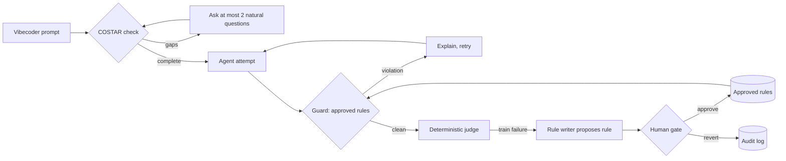

# VibeGuard

**A self-tightening agent harness that protects vibecoders' money and time.**

Most guardrails police the model. VibeGuard's guardrails protect the *user*: the non-technical builder who pays for every retry, every runaway loop and every leaked key. When an agent's output fails an eval, VibeGuard writes a new guardrail rule, a human approves it, and every later run loads it. Agents may tighten their own leash; only humans loosen it.

Built at the Cerebral Valley × MongoDB **Harness Engineering & Model Wrangling** hackathon, SF Tech Week, October 11, 2026. Track: **Problem Statement 1, Recursive Harnessing**, using a hard metric signal (held-out pass rate) in the spirit of Statement 2.

## How it works



1. **COSTAR check.** Each prompt is scored on Context, Objective, Style, Tone, Audience and Response format with a cheap CPU check. Missing dimensions trigger at most two plain-language questions, most expensive gaps first.
2. **Attempt and guard.** The agent's candidate is checked against every approved rule before it ships. A violation is explained to the agent and it retries.
3. **Judge.** One yes/no detector per failure category (cost, secrets, destructive commands) plus required-code checks. No LLM-as-judge, so runs are reproducible.
4. **Rule writer.** Failures on *training* tasks become proposed rules with provenance (run, task, failure category). Held-out tasks are only ever measured.
5. **Human gate.** Only a human can approve a rule, and only a human can loosen or revert one. Nothing is deleted: a revert keeps the rule with `status: reverted` and an audit entry.

### Memory mapping (MongoDB Atlas Agent Engine)

| Agent Engine memory type | VibeGuard record |
| --- | --- |
| Procedural | Versioned guardrail rules |
| Episodic | Run traces and metrics |
| Semantic | Vibecoder lexicon: phrasing → canonical engineering label |
| Taxonomic | Failure categories, each a binary signal |

Records live as Markdown files with YAML front matter in [`wiki/`](wiki/) and are being ported to MongoDB Atlas.

## Quickstart

Requires Python 3.11+.

```bash
python -m venv .venv
# Windows: .venv\Scripts\activate    macOS/Linux: source .venv/bin/activate
pip install -e ".[dev]"
pytest -q

# Five runs; the named human approves each proposed rule between runs
python -m vibeguard --wiki /tmp/vg demo --approver human:yourname

# Inspect and govern rules
python -m vibeguard --wiki /tmp/vg rules
python -m vibeguard --wiki /tmp/vg revert VG-0001 --as human:yourname --reason "too broad"

# COSTAR check on a prompt
python -m vibeguard costar "make it take payments"
```

### Workbench dashboard

```bash
pip install -e ".[api]"
# Windows PowerShell: $env:VIBEGUARD_WIKI="wiki"   macOS/Linux: export VIBEGUARD_WIKI=wiki
uvicorn --factory vibeguard.api:create_app --port 8000
# open http://localhost:8000  (API docs at /docs)
```

Run an evaluation, approve or revert proposed rules as a named human, re-run, and watch held-out pass rate move. `VIBEGUARD_STORE=atlas` switches storage to the Atlas backend once it lands at `vibeguard.storage.atlas.AtlasStore`.

## Results

Scores are reported only from runs executed in the current checkout. See [`docs/RESULTS.md`](docs/RESULTS.md).

## Honest limits

- **The agent is a `ScriptedAgent`.** It replays recorded candidates in order, so attempts are simulated and no live model calls are made. An LLM agent plugs into the same `attempt()` call.
- **The judge and the rule writer share regex detectors.** This validates the harness mechanics (propose → approve → enforce → measure), not general model quality.
- **No dollar savings are claimed.** A blocked candidate costs one more attempt; the claim is that it stops shipping a runaway loop, a leaked key or a destructive command.
- **Actors are labels.** `human:` and `agent:` prefixes are prototype identity, not verified authentication.
- **One failure class is out of reach by design.** The double-click bug (`t09`) can't be caught by a pattern rule, so training tops out at 9/10.

## Prior work and inspiration

VibeGuard borrows **research and architectural framing only** from RRFlow, the author's pre-alpha reasoning-data engine. No RRFlow code is copied or depended on.

Source: [`rrflow/rrflow-development`](https://github.com/rrflow/rrflow-development) at commit `cfa0e80`.

- **ADR-0002, adaptive reasoning with governed durable effects** ([`docs/decisions/0002-adaptive-reasoning-governed-effects.md`](https://github.com/rrflow/rrflow-development/blob/cfa0e80/docs/decisions/0002-adaptive-reasoning-governed-effects.md)). Reasoning stays adaptive; anything durable crosses an authorized, checked, receipted boundary. In VibeGuard a proposed rule has no effect until a human approves it.
- **Paired eval fixtures and dated results** ([`eval/`](https://github.com/rrflow/rrflow-development/tree/cfa0e80/eval)). Baseline and runtime prompt pairs informed the frozen train / held-out split.
- **Bounded, provider-neutral context assembly** ([context assembly contract](https://github.com/rrflow/rrflow-development/blob/cfa0e80/docs/architecture/engine-data-flow.md#context-assembly-contract)). The COSTAR check and approved rules are the inputs to that kind of bounded context step.

## Original contributions (built today)

- Monotonic rule gate: agents propose, humans approve, humans alone loosen or revert, append-only audit.
- Eval-driven rule writer with provenance on every rule.
- Frozen 16-task vibecoder eval set (10 train, 6 held-out) with a deterministic judge and Wilson 95% intervals.
- COSTAR completeness check with a hand-set decision boundary and natural, capped questions.
- Vibecoder lexicon mapping everyday phrasing to canonical engineering terms.
- Flat-file "LLM wiki" memory designed to port onto Atlas Agent Engine's four memory types.

## Repository layout

| Path | What it owns |
| --- | --- |
| `src/vibeguard/costar/` | COSTAR schema, check, side-conversation questions |
| `src/vibeguard/rules/` | GuardrailRule schema and the approve/revert gate |
| `src/vibeguard/evals/` | Frozen tasks and the deterministic judge |
| `src/vibeguard/loop/` | Attempt → guard → judge → propose loop, metrics |
| `src/vibeguard/lexicon/`, `failures/` | Semantic and taxonomic seed memory |
| `src/vibeguard/storage/` | Flat-file store (Atlas backend in progress) |
| `wiki/` | The flat-file memory itself |
| `AGENTS.md`, `SCOPE.md` | Map for coding agents; delivery scope |
