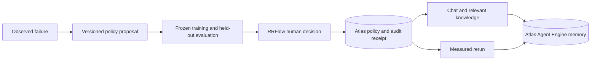

# VibeGuard

**An agent harness that learns from failures, measures changes, and remembers the decisions.**

**Live:** https://vibeguard.shippin.ai (= https://vibeguard-mv4df1w6qok-prod.cloud.modelence.app) — deployed on Modelence Cloud, data in MongoDB Atlas. The deployed build is branch [`live`](https://github.com/EonsofStupid/vibeguard/tree/live) (dashboard gate + provenance); `main` additionally carries the chat panel and the RRFlow review gate (`web/src/server/review/`), merged late on the day and not yet deployed.

**Demo video:** `docs/demo/vibeguard-demo.mp4` (55 s screen recording of the live loop) with `docs/demo/vibeguard-demo.srt` captions.

[Demo](https://vibeguard.shippin.ai) · [Walkthrough](docs/DEMO.md) · [Problem statements](docs/FOCUS.md) · [Delivery evidence](SCOPE.md) · [Contributing](CONTRIBUTING.md)

VibeGuard brings a working conversation, MongoDB Atlas memory, measured harness improvements, and RRFlow human review into one workbench. Contextual knowledge drops explain recall cooldowns and approval receipts while the user builds.

Built for the MongoDB Harness Engineering & Model Wrangling hackathon, October 11, 2026. Our two targets are **adaptive harness architecture** and **coherent memory with metric-driven progress toward long-term goals**. A short demo establishes a bounded improvement cycle; billion-token continuity remains an unmeasured scale goal.

## The improvement example

A real memory-recall request encountered an embedding rate limit. A live model proposed a scoped **60-second recall cooldown**: avoid repeated recall calls during that pause, continue recording turns, explain unavailable recall, and resume afterward. The proposal is evaluated against frozen cases before a human decides whether it becomes active.

| Recorded incident replay | Before | Proposed policy |
| --- | ---: | ---: |
| Training cases passed | 1 / 3 | 3 / 3 |
| Held-out cases passed | 1 / 4 | 4 / 4 |
| Avoidable recall attempts | 8 | 0 |
| Simulated conversation turns recorded | 51 | 51 |
| Regressions / false blocks | — | 0 / 0 |

**These are incident-derived replay results with simulated follow-up timings, not a live throughput or cost-savings measurement.** One successful live model request authored the candidate. Earlier transport and provenance-validation failures remain in the evidence history. Human approval, activation, and a rerun are distinct states in the UI; a good trial cannot approve itself.

[Exact experiment](artifacts/improvement/context-replay-20261011T224404Z.json) · proposal `context-replay-20261011T224404Z-proposal-v1` · policy hash `800fe2e7e50fc730b6c252c758cba7509edf1b0d1e8683cd31418895395b92df`.

The earlier live retry baseline passed all seven cases and generated **no improvement proposal**. Older scripted examples remain labeled fixture demonstrations.

## One path through the product



- **Modelence** serves the React workbench and server methods.
- **MongoDB Atlas** stores experiment evidence, proposals, active versions, cooldown state, and audit receipts. The application explicitly selects the existing Atlas database for this path.
- **Atlas Agent Engine** hosts conversation memory and the RRFlow review agent. Service-account OAuth connects the application to both services.
- **RRFlow** suspends execution for a real human decision, checks the exact proposal version and hash, and commits the policy with its receipt in a transaction.
- **Approved scope is reusable.** Future chats apply that version automatically. A new boundary requires a new decision; review notes alone cannot alter a policy.

## Verified evidence and limits

Hosted memory has acknowledged real turns and a semantic project-goal fact. That fact was retrieved in a different session, and an actual chat reply and its two turns were independently checked in Atlas. [SCOPE.md](SCOPE.md) records the checkpoint artifacts and remaining work.

The measured cooldown proposal and experiment were written to Atlas and independently read back. RRFlow is deployed and the actual proposal reached its native human-review interrupt. Read current approval and activation state from Atlas; the scores do not establish activation.

The domain serves a Modelence deployment. An uploaded source bundle is a separate deployment from a Git push. A local successful build alone does not verify production chat.

| Memory role | Application records |
| --- | --- |
| Procedural | Versioned rules and approved context policies |
| Episodic | Runs, experiments, and rerun measurements |
| Semantic | Project facts and terminology |
| Taxonomic | Failure categories |
| Audit | Human decisions and execution receipts |

These mappings alone do not prove that every type has been extracted or recalled by the hosted service. Replay measurements do not establish live throughput. Prototype reviewer names label receipts; they are not production identity verification.

## Run the workbench

Node.js 22 and Python 3.11+ are the development baseline. Local hooks and CI setup are in [CONTRIBUTING.md](CONTRIBUTING.md).

```powershell
cd web
npm ci
Copy-Item .env.example .env
# Fill existing Atlas, model and Agent Engine service-account values.
npm run build
cd ..
node tools/start-workbench.mjs
```

The launcher reads `web/.env`, selects an available port, verifies the built page, and prints its URL. Keep the terminal open. `node tools/start-workbench.mjs status` reports that owned workbench; `node tools/start-workbench.mjs stop` or Ctrl+C stops it and its workers. A second launch reuses the running instance. An explicit `--port` remains available. The launcher does not stop manually started servers.

The older Next.js development launcher remains available with `node tools/start-chat.mjs` and has its own ownership record. The Modelence workbench is the main submission UI.

For hosted memory, use the installed Agent Engine CLI. Docker is needed only for the separate local memory stack.

```powershell
.\agentengine.exe version
.\agentengine.exe memory status --context hack --no-log
.\.tools\python\python.exe tools\hosted_memory.py
```

## Deploy the existing Modelence app

```powershell
cd web
npx modelence deploy --app vibeguard-mv4df1w6qok --env prod
```

`web/modelence.config.json` declares build commands and runtime settings. Provide its required secrets in the existing Modelence environment, using the same Atlas and Agent Engine project as the local application. Keep credentials out of source and recordings.

After deployment, verify **App Started**, load the custom domain, send a real chat message, check both memory receipts, and refresh the RRFlow queue. Verify the displayed experiment and active version. A timeout, an HTTP 200 for the page shell, or a Git push does not verify that complete path.

## RRFlow research and original work

The design draws on [rrflow/rrflow-development at `cfa0e8073c1a5479427beb29c7c88ee0a71f2f01`](https://github.com/rrflow/rrflow-development/commit/cfa0e8073c1a5479427beb29c7c88ee0a71f2f01), verified through the public GitHub API and the files at that revision. The Rust engine is not imported.

- [ADR-0002: adaptive reasoning with governed durable effects](https://github.com/rrflow/rrflow-development/blob/cfa0e8073c1a5479427beb29c7c88ee0a71f2f01/docs/decisions/0002-adaptive-reasoning-governed-effects.md) separates adaptive exploration from authorized, checked and receipted durable changes. Drafts have no mutation authority. VibeGuard applies that principle through explicit human activation of an exact tested policy.
- [Context assembly contract](https://github.com/rrflow/rrflow-development/blob/cfa0e8073c1a5479427beb29c7c88ee0a71f2f01/docs/architecture/engine-data-flow.md#context-assembly-contract) defines `POST /v1/context/assemble`: one provider-neutral operation with request budgets, source evidence, a shared read stamp and explicit truncation. This guides VibeGuard's scoped memory and context-policy boundary; it does not establish that VibeGuard implements RRFlow's engine or its scale targets.
- [Paired evaluation prompts](https://github.com/rrflow/rrflow-development/tree/cfa0e8073c1a5479427beb29c7c88ee0a71f2f01/eval/prompts) and the [2026-08-18 result artifact](https://github.com/rrflow/rrflow-development/blob/cfa0e8073c1a5479427beb29c7c88ee0a71f2f01/eval/results/2026-08-18-summary.json) inform the before/after fixture pattern. That prior artifact reports a small controlled sample and explicitly rejects a universal efficiency claim. Its measurements are not VibeGuard results.

VibeGuard's contributions are the experiment/proposal loop, frozen evaluation and promotion checks, Atlas transactions and version-bound receipts, hosted RRFlow review implementation, memory-backed chat, and contextual explanations. The research boundary and claims are documented in [FOCUS.md](docs/FOCUS.md).

## Repository map

| Path | Responsibility |
| --- | --- |
| `web/` | Modelence chat, improvement UI, review integration, Atlas policy enforcement |
| `rrflow/agents/rrflow/` | Hosted review agent and independent decision verifier |
| `src/vibeguard/improvement/` | Experiments, frozen cases, proposal persistence, approved rerun |
| `src/vibeguard/{rules,evals,loop,storage}/` | Reference harness, fixture evaluator, rule gate, stores |
| `src/vibeguard/{memory,context,lexicon,failures,costar}/` | Memory bridge, retrieval, terminology, taxonomy, prompt context |
| `artifacts/` | Credential-free executed evidence, including failures |
| `docs/` | Scope, setup, demo, and architecture records |
| `wiki/` | Original Markdown research records |

Agents should read [AGENTS.md](AGENTS.md), [FOCUS.md](docs/FOCUS.md), and [SCOPE.md](SCOPE.md) before changing the product.
