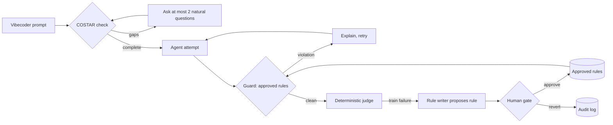

# VibeGuard

**A self-tightening agent harness that protects vibecoders' money and time.**

Most guardrails police the model. VibeGuard's guardrails protect the *user*: the non-technical builder who pays for every retry, every runaway loop and every leaked key. When an agent's output fails an eval, VibeGuard writes a new guardrail rule, a human approves it, and every later run loads it. Agents may tighten their own leash; only humans loosen it.

Built at the Cerebral Valley × MongoDB **Harness Engineering & Model Wrangling** hackathon, SF Tech Week, October 11, 2026. Track: **Problem Statement 1, Recursive Harnessing**, using a hard metric signal (held-out pass rate) in the spirit of Statement 2.

## How it works

1. **COSTAR check.** Each prompt is scored on Context, Objective, Style, Tone, Audience and Response format with a cheap CPU check. Missing dimensions trigger at most two plain-language questions, most expensive gaps first.
2. **Attempt and guard.** The agent's candidate is checked against every approved rule before it ships. A violation is explained to the agent and it retries.
3. **Judge.** One yes/no detector per failure category (cost, secrets, destructive commands) plus required-code checks. No LLM-as-judge, so runs are reproducible.
4. **Rule writer.** Failures on *training* tasks become proposed rules with provenance (run, task, failure category). Held-out tasks are only ever measured.
5. **Human gate.** Only a human can approve a rule, and only a human can loosen or revert one. Nothing is deleted: a revert keeps the rule with `status: reverted` and an audit entry.

### Memory mapping

| Memory type | VibeGuard record |
| --- | --- |
| Procedural | Versioned guardrail rules |
| Episodic | Run traces and metrics |
| Semantic | Vibecoder lexicon: phrasing → canonical engineering label |
| Taxonomic | Failure categories, each a binary signal |

Research records live as Markdown files with YAML front matter in [`wiki/`](wiki/). The workbench uses separate local `.runtime/wiki` records unless MONGODB_URI is set. The Atlas backend implements this interface; live database access remains pending. The generated Agent Engine chat/review client is in vibeguard/. Its live targets, shared memory and RRFlow review handoff still need integration; running engines are user-reported, not verified invocations here.

## Current chat test

The chat client is configured for explicit live-model mode. From the repository root:

~~~text
corepack pnpm --dir vibeguard run dev --hostname 127.0.0.1 --port 3001
~~~

Open http://127.0.0.1:3001/. A separate model probe completed, but the agent-started app request failed; a working browser reply still needs verification from this normal-terminal launch. TypeScript and 70 client tests pass. Conversation history is browser-local; RRFlow review and Atlas memory remain pending. Failures are visible and no invocation POST is automatically retried. See [chat checkpoint](artifacts/chat-checkpoint.json) and [execution runbook](docs/EXAMPLE-FIRST.md).

## Run the fixture workbench locally

From this folder, run:

~~~powershell
./run.ps1
~~~

Open http://127.0.0.1:8765. The provided Windows portable runtime is in the ignored .tools folder. For a fresh checkout with Python 3.11+:

~~~powershell
python -m pip install -e ".[atlas,dev]"
python -m vibeguard.web
python -m pytest -q
~~~

The workbench uses the actual Python harness. It starts with a separate local .runtime/wiki store so existing research records remain intact. An explicitly configured Atlas connection must succeed at startup; it never silently falls back to local storage.

## MongoDB integration

The vibeguard cluster was verified in Atlas: M10, MongoDB 8.0.34, AWS us-west-1, three-node replica set, backups active.

Copy .env.example to .env when setting up a fresh checkout. Populate MONGODB_URI with the driver connection string and an existing database user's credentials; set MONGODB_DATABASE=vibeguard. The app creates rules, runs, lexicon, failures, costar, facts and audit collections. Rule transitions use majority-committed MongoDB transactions, including a receipt and version check. Audit events are appended and rule reverts preserve records. The runtime database user needs read/write access to this database.

Atlas database credentials and Voyage AI model API keys are different. VOYAGE_API_KEY connects to https://us.ai.mongodb.com/v1 for this US-scoped key. The Test Voyage API action makes one bounded embedding request. The server-side context client also implements approved-rule reranking; it is not yet connected to the draft-check workflow. API availability and retrieval need live verification. Keys never appear in browser responses or logs.

## CLI and optional API

~~~powershell
python -m vibeguard costar "make it take payments"
python -m vibeguard --wiki ./wiki rules
python -m vibeguard --wiki ./wiki revert VG-0001 --as human:yourname --reason "too broad"
~~~

The existing FastAPI interface is optional and shares the promotion evidence check. To run its tests, install the api extras and httpx. The primary UI uses the dependency-light workbench server above.

## Results

The isolated recorded replay produces held-out passes of 1/6, 3/6, 5/6, 6/6, 6/6 with zero false blocks. [Executed evidence](artifacts/replay-evidence.json) explicitly marks synthetic human approvals in a temporary store. The actual workbench rule remains proposed for human review. These are harness mechanics, not independent live-model results. The workbench displays the frozen dataset hash, task traces and training-only promotion checks.

## Honest limits

- **The agent is a `ScriptedAgent`.** It replays recorded candidates in order, so attempts are simulated and no live model calls are made. An LLM agent plugs into the same `attempt()` call.
- **The judge and the rule writer share regex detectors.** This validates the harness mechanics (propose → approve → enforce → measure), not general model quality.
- **No dollar savings are claimed.** A blocked candidate costs one more attempt; the claim is that it stops shipping a runaway loop, a leaked key or a destructive command.
- **Actors are labels.** `human:` and `agent:` prefixes are prototype identity, not verified authentication.
- **One failure class is out of reach by design.** The double-click bug (`t09`) can't be caught by a pattern rule, so training tops out at 9/10.

## Prior work and inspiration

VibeGuard borrows **research and architectural framing only** from RRFlow, the author's pre-alpha reasoning-data engine. No RRFlow code is copied or depended on.

Source: [`rrflow/rrflow-development`](https://github.com/rrflow/rrflow-development) at commit `cfa0e80`.

- **ADR-0002, adaptive reasoning with governed durable effects** ([`docs/decisions/0002-adaptive-reasoning-governed-effects.md`](https://github.com/rrflow/rrflow-development/blob/cfa0e80/docs/decisions/0002-adaptive-reasoning-governed-effects.md)). Reasoning stays adaptive; anything durable crosses an authorized, checked, receipted boundary. In VibeGuard a proposed rule has no effect until a human approves it.
- **Paired eval fixtures and dated results** ([`eval/`](https://github.com/rrflow/rrflow-development/tree/cfa0e80/eval)). Baseline and runtime prompt pairs informed the frozen train / held-out split.
- **Bounded, provider-neutral context assembly** ([context assembly contract](https://github.com/rrflow/rrflow-development/blob/cfa0e80/docs/architecture/engine-data-flow.md#context-assembly-contract)). The COSTAR check and approved rules are the inputs to that kind of bounded context step.

## Original contributions (built today)

- Native Windows runtime and a clean workbench with explicit human review.
- Training-only promotion check, bounded retries, rejected rule-ID replacement and accurate exhausted-draft outcomes.
- Atlas transactions for rule transitions and versioned receipts.

- Monotonic rule gate: agents propose, humans approve, humans alone loosen or revert, append-only audit.
- Eval-driven rule writer with provenance on every rule.
- Frozen 16-task vibecoder eval set (10 train, 6 held-out) with a deterministic judge and Wilson 95% intervals.
- COSTAR completeness check with a hand-set decision boundary and natural, capped questions.
- Vibecoder lexicon mapping everyday phrasing to canonical engineering terms.
- Flat-file "LLM wiki" memory designed to port onto Atlas Agent Engine's four memory types.

## Repository layout

| Path | What it owns |
| --- | --- |
| `src/vibeguard/costar/` | COSTAR schema, check, side-conversation questions |
| `src/vibeguard/rules/` | GuardrailRule schema and the approve/revert gate |
| `src/vibeguard/evals/` | Frozen tasks and the deterministic judge |
| `src/vibeguard/loop/` | Attempt → guard → judge → propose loop, metrics |
| `src/vibeguard/lexicon/`, `failures/` | Semantic and taxonomic seed memory |
| `src/vibeguard/storage/` | Flat-file and Atlas stores; transactional rule receipts |
| `src/vibeguard/web/` | Primary workbench, actual harness API and static UI |
| `src/vibeguard/context/` | Bounded MongoDB Voyage embedding and reranking calls |
| `wiki/` | The flat-file memory itself |
| `AGENTS.md`, `SCOPE.md` | Map for coding agents; delivery scope |

## Verified delivery checkpoint

34 active tests pass; the optional FastAPI module is skipped because FastAPI is not installed in the portable runtime. Browser baseline, draft checking, error states and persistence across restart were verified. dnspython 2.8.0 is installed. An authenticated Voyage embedding request returned HTTP 200 with voyage-code-4 and a 1024-dimension vector; see artifacts/voyage-check.json. The app process is still restricted from opening outbound sockets in this agent environment; that is a permission failure, not a timeout. Run ./tools/check-voyage.ps1 from your own PowerShell to verify the client outside that environment. A database user, MONGODB_URI and a live Atlas round trip are still required. See [SCOPE.md](SCOPE.md) for checkpoint evidence and remaining work.

## Working examples and shared memory

[Execution runbook](docs/EXAMPLE-FIRST.md) covers the first three examples, VibeGuard chat and RRFlow review roles, shared memory provisioning and the live RSI acceptance boundary. Start with `.tools/python/python.exe tools/preview_examples.py`; it detects failures and proposes rules without activating them.
