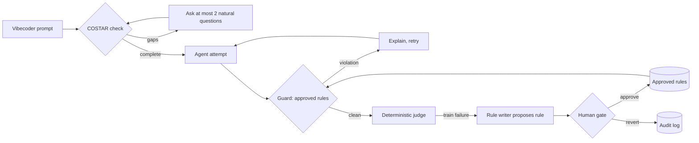

# VibeGuard

**A self-tightening agent harness that protects vibecoders' money and time.**

**Live:** https://vibeguard-mv4df1w6qok-prod.cloud.modelence.app — deployed on Modelence Cloud, data in MongoDB Atlas.

Most guardrails police the model. VibeGuard's guardrails protect the *user*: the non-technical builder who pays for every retry, every runaway loop and every leaked key. When an agent's output fails an eval, VibeGuard writes a new guardrail rule, a human approves it, and every later run loads it. **Agents may tighten their own leash; only humans loosen it.**

Built solo at the Cerebral Valley × MongoDB **Harness Engineering & Model Wrangling** hackathon, SF Tech Week, October 11, 2026.
Statement 1 (**Recursive Harnessing**): the harness evolves its own rules and context policy. Statement 2 (**long-horizon memory**): every run and rule lands in the four Atlas Agent Engine memory types and a hard metric (held-out pass rate) drives progress.

## What the live app proves (numbers from the deployed loop, 2026-10-11)

| Run | Rules active | Train | Held-out | Held-out 95% CI | Blocked before shipping | False blocks |
| --- | --- | --- | --- | --- | --- | --- |
| run_001 | none | 1/10 | 1/6 | 3%–56% | 0 | 0 |
| run_002 | VG-0001 (cost) | 4/10 | 3/6 | 19%–81% | 5 | 0 |
| run_003 | + VG-0002 (secrets) | 7/10 | 5/6 | 44%–97% | 10 | 0 |
| run_004 | + VG-0003 (destructive) | 9/10 | 6/6 | 61%–100% | 13 | 0 |
| run_005 | same | 9/10 | 6/6 | 61%–100% | 13 | 0 |

Each rule was proposed by the agent from a *training* failure and approved by a human (`human:jesse`) before the next run; held-out tasks only ever get measured. The same loop run by the Python harness against the M10 cluster gives identical numbers ([docs/RESULTS.md](docs/RESULTS.md)).

## Architecture

```
vibecoder prompt ──► COSTAR check ──► agent attempt ──► guard (approved rules) ──► deterministic judge
                        │ gaps: ≤2 questions                 │ violation: explain + retry        │ train failure
                        ▼                                    ▼                                   ▼
                 lexicon ($vectorSearch, Voyage)      episodic run trace                 proposed rule ──► HUMAN GATE ──► approved / reverted (+ receipt)
```

| Layer | Where | What |
| --- | --- | --- |
| Judges' view + harness API | `web/` — Modelence (TypeScript, React 19) on **Modelence Cloud** | `harness` module: queries `summary`, `costar`, `memoryTypes`; mutations `runEvaluation`, `approveRule`, `revertRule`, `seed`, `reset` |
| Harness engine (reference) | `src/vibeguard/` — Python | Same schemas, judge, gate and loop; CLI `python -m vibeguard demo --approver human:you --memory` |
| Data | **MongoDB Atlas** | collections `rules` `runs` `lexicon` (1024-d Voyage embeddings + `$vectorSearch` index `lexicon_vec`) `failures` `audit` |
| Platform memory | **Atlas Agent Engine** hosted memory (`agent-engine-sdk-memory`) | `src/vibeguard/memory/agent_engine.py` mirrors rules→procedural, runs→episodic, lexicon→semantic, failures→taxonomic and calls `build_context()` before every attempt |

### Memory mapping (Atlas Agent Engine types)

| Memory type | VibeGuard record | Collection | Hosted memory call |
| --- | --- | --- | --- |
| Procedural | Versioned guardrail rules | `rules` | `save_procedure` / `discover_procedures` |
| Episodic | Run traces and metrics | `runs` | `save_episode` / `search_episodes` |
| Semantic | Vibecoder lexicon: phrasing → canonical engineering label | `lexicon` | `save_semantic` / `search_semantic` |
| Taxonomic | Failure categories, each a binary signal | `failures` | `save_taxonomic` / `search_taxonomic` |
| Receipts | Every propose / approve / revert | `audit` | — (append-only, never deleted) |

The **context policy** is measured, not asserted: `ContextPolicy` (per task) records how many memories of each type `build_context()` selected; `RunResult.context_memories` sums it per run, so the context the agent sees grows as rules are approved.

## Deploy / run

```bash
# Judges' app (Modelence Cloud builds from source: npm ci && npm run build; start: npm start)
cd web && npx modelence@latest deploy        # modelence.config.json describes the build; MONGODB_URI is injected
# set VOYAGE_API_KEY in the environment's variables to enable $vectorSearch lexicon recall

# Python harness against Atlas (+ hosted memory)
cp .env.example .env                          # MONGODB_URI, VOYAGE_API_KEY, service-account id/secret, AGENTIC_MEMORY_PROJECT_ID
VIBEGUARD_STORE=atlas python -m vibeguard demo --approver human:you --memory
VIBEGUARD_STORE=atlas python -m vibeguard memory-sync      # mirror everything into the four hosted memory types
python -m vibeguard memory-context "add stripe checkout to my next.js app"
```

## How it works



1. **COSTAR check.** Each prompt is scored on Context, Objective, Style, Tone, Audience and Response format with a cheap CPU check. Missing dimensions trigger at most two plain-language questions, most expensive gaps first.
2. **Attempt and guard.** The agent's candidate is checked against every approved rule before it ships. A violation is explained to the agent and it retries.
3. **Judge.** One yes/no detector per failure category (cost, secrets, destructive commands) plus required-code checks. No LLM-as-judge, so runs are reproducible.
4. **Rule writer.** Failures on *training* tasks become proposed rules with provenance (run, task, failure category). Held-out tasks are only ever measured.
5. **Human gate.** Only a human can approve a rule, and only a human can loosen or revert one. Nothing is deleted: a revert keeps the rule with `status: reverted` and an audit entry.

### Memory mapping

| Memory type | VibeGuard record |
| --- | --- |
| Procedural | Versioned guardrail rules |
| Episodic | Run traces and metrics |
| Semantic | Vibecoder lexicon: phrasing → canonical engineering label |
| Taxonomic | Failure categories, each a binary signal |

Research records also live as Markdown files with YAML front matter in [`wiki/`](wiki/) (the flat-file "LLM wiki" the Atlas collections mirror). A generated Agent Engine chat/review client lives in `vibeguard/` and a Python fixture workbench in `src/vibeguard/web/` (`./run.ps1`); both are experiments beside the deployed app and are not part of the demo path.

## CLI and optional API

~~~powershell
python -m vibeguard costar "make it take payments"
python -m vibeguard --wiki ./wiki rules
python -m vibeguard --wiki ./wiki revert VG-0001 --as human:yourname --reason "too broad"
~~~

The existing FastAPI interface is optional and shares the promotion evidence check. To run its tests, install the api extras and httpx. The primary UI uses the dependency-light workbench server above.

## Results (Python workbench replay)

The isolated recorded replay produces held-out passes of 1/6, 3/6, 5/6, 6/6, 6/6 with zero false blocks. [Executed evidence](artifacts/replay-evidence.json) explicitly marks synthetic human approvals in a temporary store. The actual workbench rule remains proposed for human review. These are harness mechanics, not independent live-model results. The workbench displays the frozen dataset hash, task traces and training-only promotion checks.

## Honest limits

- **The agent is a `ScriptedAgent`.** It replays recorded candidates in order, so attempts are simulated and no live model calls are made. An LLM agent plugs into the same `attempt()` call.
- **The judge and the rule writer share regex detectors.** This validates the harness mechanics (propose → approve → enforce → measure), not general model quality.
- **No dollar savings are claimed.** A blocked candidate costs one more attempt; the claim is that it stops shipping a runaway loop, a leaked key or a destructive command.
- **Actors are labels.** The gate checks the `human:` / `agent:` prefix; the deployed app binds the actor to the signed-in Modelence user when there is one and otherwise trusts the label. Production hardening = require sign-in.
- **Hosted memory is a mirror, not the source of truth.** Rules/runs live in VibeGuard's own Atlas collections; the Agent Engine memory bridge mirrors them and asks `build_context()` for the context policy. If the hosted gateway is unavailable the loop still runs (memory off = `context: null` in the trace).
- **One failure class is out of reach by design.** The double-click bug (`t09`) can't be caught by a pattern rule, so training tops out at 9/10.

## Prior work and inspiration

VibeGuard borrows **research and architectural framing only** from RRFlow, the author's pre-alpha reasoning-data engine. No RRFlow code is copied or depended on.

Source: [`rrflow/rrflow-development`](https://github.com/rrflow/rrflow-development) at commit `cfa0e80`.

- **ADR-0002, adaptive reasoning with governed durable effects** ([`docs/decisions/0002-adaptive-reasoning-governed-effects.md`](https://github.com/rrflow/rrflow-development/blob/cfa0e80/docs/decisions/0002-adaptive-reasoning-governed-effects.md)). Reasoning stays adaptive; anything durable crosses an authorized, checked, receipted boundary. In VibeGuard a proposed rule has no effect until a human approves it.
- **Paired eval fixtures and dated results** ([`eval/`](https://github.com/rrflow/rrflow-development/tree/cfa0e80/eval)). Baseline and runtime prompt pairs informed the frozen train / held-out split.
- **Bounded, provider-neutral context assembly** ([context assembly contract](https://github.com/rrflow/rrflow-development/blob/cfa0e80/docs/architecture/engine-data-flow.md#context-assembly-contract)). The COSTAR check and approved rules are the inputs to that kind of bounded context step.

## Original contributions (built today)

- The deployed judges' view on Modelence Cloud: pass-rate curve with Wilson intervals and rule annotations, the human gate (approve / revert), COSTAR panel with `$vectorSearch` lexicon recall, append-only receipts, memory-type counts.
- Atlas Agent Engine memory bridge (`src/vibeguard/memory/`): the four memory types written from the loop, `build_context()` before every attempt, measured context policy per run.
- Training-only promotion check, bounded retries, rejected rule-ID replacement and accurate exhausted-draft outcomes.
- Atlas transactions for rule transitions and versioned receipts.

- Monotonic rule gate: agents propose, humans approve, humans alone loosen or revert, append-only audit.
- Eval-driven rule writer with provenance on every rule.
- Frozen 16-task vibecoder eval set (10 train, 6 held-out) with a deterministic judge and Wilson 95% intervals.
- COSTAR completeness check with a hand-set decision boundary and natural, capped questions.
- Vibecoder lexicon mapping everyday phrasing to canonical engineering terms.
- Flat-file "LLM wiki" memory designed to port onto Atlas Agent Engine's four memory types.

## Repository layout

| Path | What it owns |
| --- | --- |
| `src/vibeguard/costar/` | COSTAR schema, check, side-conversation questions |
| `src/vibeguard/rules/` | GuardrailRule schema and the approve/revert gate |
| `src/vibeguard/evals/` | Frozen tasks and the deterministic judge |
| `src/vibeguard/loop/` | Attempt → guard → judge → propose loop, metrics |
| `src/vibeguard/lexicon/`, `failures/` | Semantic and taxonomic seed memory |
| `src/vibeguard/storage/` | Flat-file and Atlas stores; transactional rule receipts |
| `src/vibeguard/memory/` | Atlas Agent Engine hosted-memory bridge (four memory types + `build_context`) |
| `web/` | Modelence app: `src/server/harness/` (TypeScript port of the harness) and `src/client/pages/HomePage.tsx` (judges' view) |
| `src/vibeguard/web/` | Primary workbench, actual harness API and static UI |
| `src/vibeguard/context/` | Bounded MongoDB Voyage embedding and reranking calls |
| `wiki/` | The flat-file memory itself |
| `AGENTS.md`, `SCOPE.md` | Map for coding agents; delivery scope |
